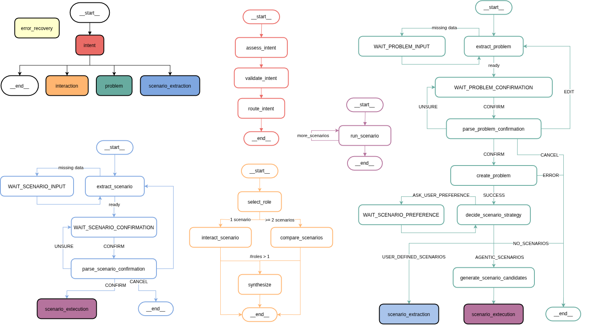

# DIGITAL TWIN AGENT

This projects aims contains the first prototype of an Agentic AI for the Digital Twin project.

## Core idea

Model the system as a separate service exposing APIs that can be called both from a UX (e.g, webpage) or programmatically.

The system is a context-aware, stateful, multi-node agent with explicit routing. In this way each node has clear boundaries and responsibilities.
Below a visual representation of the states is presented.



## Usage

### Debugging
To generate basic conversation samples you can expoit the pytest functionality.
Running

```
pytest
```
will print conversations to `log` folder.
Make sure `DRAW_CONVERSATION` is set to *True* in app/config.py file, otherwise conversaion will be printed in textual format.

### Production
You can run the agentic system as a service with the following command

```
uvicorn app.main:app --reload --port 9000
```

A different port can be used, just change it so that it does not conflic with overtourism, ollama or other services.

### Demo

A UX is implemented for demo proposal (later this can be expanded into a production front-end).
To run it move to `chatbot-fronted` folder and then type

```
npm start
```

Refer to chatbot-fronted README for more details.

## TODO:
- Chat-only interface
- Trace interaction steps (tool cals, decisions)
- Itegration with front-end + memory handling

## Open points and future improvements

- Dialog flexibility
    - Fixed conversation structure (pro: stable and predictable, cons: might feel unnatural)
    - Fixed messages (e.g. for confirmation). Addding variablity might increase latency.
- Error recovery might be improved with retries logic, especially for scenario
- stardard data format and language (to prevent errors in computations) + finetuning (both for computations and for synonims)
- parallelize operations (different expers or simulations)
- design token-budget-aware compression for context
